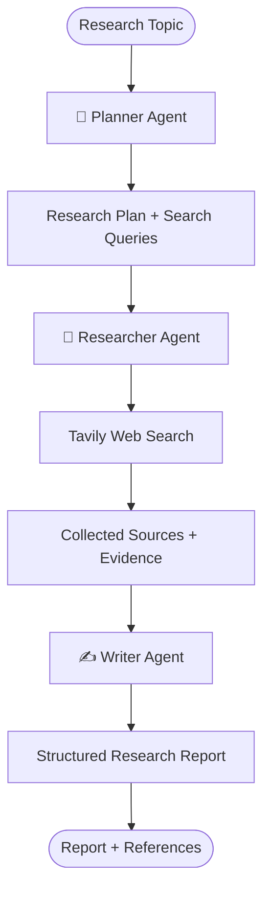

<div align="center">

# 🔎 The Research Room

### A Multi-Agent AI Research Assistant

**From a research question to a structured, evidence-backed report.**

[](https://research-room.streamlit.app/)


*Research smarter. Explore deeper. Write with evidence.*

</div>

---

## ✨ Overview

**The Research Room** is a multi-agent AI research assistant that transforms a topic into a structured research report through a coordinated workflow.

Instead of relying on a single prompt, the application separates research into specialized agents:

- 🧠 **Planner Agent** — breaks a topic into research questions and search queries.
- 🔎 **Researcher Agent** — gathers relevant web evidence using Tavily.
- ✍️ **Writer Agent** — synthesizes collected evidence into a Markdown report with numbered citations and references.

The workflow is orchestrated with **LangGraph**, while **Groq** powers the primary LLM calls and **Gemini** acts as a fallback.

> 🎯 **Goal:** Make research more organized, traceable, and easier to explore.

---

## 🚀 Live Demo

### 👉 [Launch The Research Room](https://research-room.streamlit.app/)

---

## 🧠 How It Works



### Agent Responsibilities

| Agent | Responsibility | Output |
|---|---|---|
| Planner | Understands the topic and creates focused search queries | Research plan + queries |
| Researcher | Searches the web and collects source snippets | Evidence + source metadata |
| Writer | Synthesizes evidence and organizes findings | Markdown report + references |

The agents run sequentially in a **LangGraph workflow**:

`Planner → Researcher → Writer`

---

## 🚀 Features

- 🤖 Multi-agent research workflow
- 🧠 Automated research planning
- 🔍 Web evidence collection using Tavily
- 📝 Evidence-based report generation
- 📚 Numbered citations and references
- ⚡ Groq-powered inference
- 🔄 Gemini fallback model
- 🎨 Interactive Streamlit interface
- 📄 Research report export
- 🔐 Secure API key configuration

---

## 🛠️ Tech Stack

| Technology | Role |
|---|---|
| Python | Core programming language |
| Streamlit | Interactive web application |
| LangGraph | Agent workflow orchestration |
| LangChain | LLM integration |
| Groq | Primary LLM inference |
| Google Gemini | Fallback LLM |
| Tavily | Web research and search |
| python-dotenv | Environment configuration |

---

## ⚙️ Run Locally

### 1. Clone the repository

```bash
git clone https://github.com/YOUR_GITHUB_USERNAME/Research_assistant.git
cd Research_assistant
```

### 2. Create a virtual environment

**Windows (PowerShell):**

```powershell
python -m venv .venv
.venv\Scripts\Activate.ps1
```

**macOS / Linux:**

```bash
python3 -m venv .venv
source .venv/bin/activate
```

### 3. Install dependencies

```bash
pip install -r requirements.txt
```

### 4. Configure API keys

Create a `.env` file in the project root:

```env
GROQ_API_KEY=your_groq_api_key
TAVILY_API_KEY=your_tavily_api_key
GOOGLE_API_KEY=your_gemini_api_key
MODEL_NAME=gemini-3.8-flash
```

Get your API keys:

- [Groq Console](https://console.groq.com/)
- [Tavily](https://app.tavily.com/)
- [Google AI Studio](https://aistudio.google.com/)

⚠️ **Never commit your `.env` file or expose API keys publicly.**

### 5. Run the application

```bash
streamlit run app.py
```

Open the local URL shown in your terminal.

---

## 🔐 Deployment

The application is deployed using **Streamlit Community Cloud**.

For deployment:

1. Connect the GitHub repository to Streamlit Community Cloud.
2. Set the entry point to `app.py`.
3. Configure API keys in Streamlit Secrets:

```toml
GROQ_API_KEY = "your_groq_api_key"
TAVILY_API_KEY = "your_tavily_api_key"
GOOGLE_API_KEY = "your_gemini_api_key"
MODEL_NAME = "gemini-3.8-flash"
```

4. Deploy and access the live application.

---

## 📁 Project Structure

```text
Research_assistant/
│
├── app.py                 # Streamlit UI and application entry point
├── graph.py               # Research state, agents, and LangGraph workflow
├── requirements.txt        # Python dependencies
├── .gitignore             # Excludes secrets and local files
├── .env                   # Local API keys (not committed)
└── research_history.json   # Local research history (not committed)
```

---

## 🗺️ Roadmap

- [ ] Improve source quality and evidence relevance
- [ ] Add richer source previews and citation navigation
- [ ] Improve report export and formatting
- [ ] Add persistent database-backed research history
- [ ] Introduce additional specialized research agents
- [ ] Add evaluation for report quality and factual grounding

---

## ⚠️ Limitations

- Report quality depends on retrieved sources and model output.
- Search snippets may not contain complete webpage context.
- Generated reports may contain inaccuracies; verify important claims against original sources.
- API availability, rate limits, and usage quotas can affect execution.
- Local JSON history is not a durable multi-user database and may not persist on cloud hosting.

---

## 🤝 Contributing

Contributions, ideas, and feedback are welcome!

1. Fork the repository.
2. Create a feature branch.
3. Make your changes.
4. Open a pull request describing the improvement.

---

## 👨‍💻 Author

**Yogesh**

- GitHub: [@YOUR_GITHUB_USERNAME](https://github.com/Pannu99yogesh)
- Project: [The Research Room](https://research-room.streamlit.app/)

---

<div align="center">

### Built with curiosity, evidence, and AI. 💡

⭐ If you find this project interesting, consider giving it a star!

</div>
